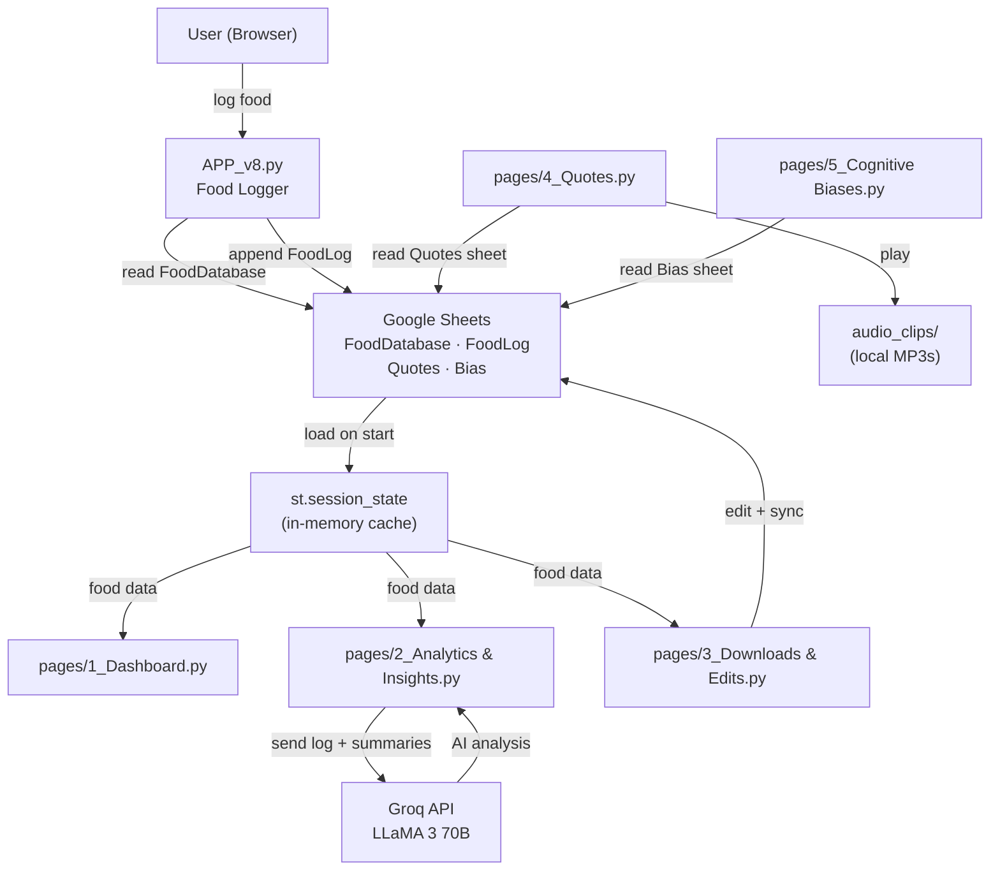

# FoodApp Codebase Audit

**Date:** 2026-03-18
**Stack:** Python · Streamlit · Google Sheets · Groq (LLaMA 3) · Plotly
**Status:** Active, personal/demo-scale app — not production-hardened

---

## 1. File-by-File Summary

| File | Status | Purpose |
|------|--------|---------|
| `APP_v8.py` | **Active** | Main food logging UI — entry point |
| `APP_v1.py` – `APP_v7.py` | Draft/Legacy | Older iterations, not used |
| `App_v4.py` | Draft/Legacy | Older iteration, not used |
| `APP_load_food_data.py` | Utility | One-time script to generate `food_database.csv` from hardcoded dict |
| `Log Your Food.py` | Legacy | Alternate entry point, not in active use |
| `pages/1_Dashboard.py` | Active | Plotly trend charts, macro visualization with threshold bands |
| `pages/2_Analytics & Insights.py` | Active | AI-powered nutrition analysis via Groq LLaMA 3 |
| `pages/3_Downloads & Edits.py` | Active | CSV export + in-app table editing synced to Google Sheets |
| `pages/4_Quotes.py` | Active | Daily quotes, mantras, Buddhist audio clip playback |
| `pages/5_Cognitive Biases.py` | Active | Daily cognitive bias education from Google Sheets |
| `pages/6_My Recipes.py` | Stub | Empty file — planned feature |
| `food_database.csv` | Data | Local cache of 34 foods with nutrition info (gitignored) |
| `food_log.csv` | Data | Local cache of food consumption logs (gitignored) |
| `audio_clips/` | Assets | 150+ Buddhist meditation MP3s for in-app playback |
| `requirements.txt` | Config | Python dependencies |
| `.devcontainer/devcontainer.json` | Config | Docker/Codespaces setup |

---

## 2. User-Facing Features

### Food Logging (APP_v8.py)
- Select food from database → enter quantity → log with calculated macros
- **Quick-add buttons** for 7 frequent foods
- **Manual entry** with custom macro values
- **New food creation** (persisted to Google Sheets FoodDatabase)
- **Miscellaneous / ad-hoc** food entry
- Log for current date or any past date
- Delete latest entry or delete by row index

### Daily Summary (APP_v8.py)
- Macro totals (Protein, Carbs, Fats, Calories) as metrics
- Protein goal progress bar (target: ~110–150g)
- Top foods by macro contribution

### Dashboard (pages/1_Dashboard.py)
- Time filters: Week / Month / Quarter / Year / All
- Per-macro or All Macros view
- Plotly line+marker charts with colored threshold bands
- Target thresholds: Protein 100–150g, Carbs 250–400g, Fats 50–90g, Calories 2000–3000
- Average daily intake, top 3 food contributors

### AI Insights (pages/2_Analytics & Insights.py)
- Timeframe selector (Today, Yesterday, Last 7/14/30/90 days, Custom range)
- Sends food log + daily summaries to Groq LLaMA 3 (llama3-70b-8192)
- Analyses macro balance, trends, missing micronutrients
- Custom prompt support for specific nutrition questions
- Configured for ~69kg muscle-building goal

### Data Management (pages/3_Downloads & Edits.py)
- CSV download for FoodDatabase and FoodLog
- In-app editable data tables (add/delete rows)
- Changes synced back to Google Sheets
- Cache clear / data refresh

### Motivational Content (pages/4_Quotes.py)
- Daily deterministic quote (same quote all day, seeded by date)
- Daily mantra display (filtered subset of quotes)
- 150+ Buddhist teaching audio clips with playback controls
- Age/days-elapsed display (DOB hardcoded: 1981-03-08)

### Education (pages/5_Cognitive Biases.py)
- Daily cognitive bias: Phenomenon, Area, Bias name, Definition, Localized Examples
- Button to reveal another bias
- Seeded by date for determinism

---

## 3. Data Model

### Entities & Storage

| Entity | Storage | Schema |
|--------|---------|--------|
| FoodDatabase | Google Sheets + local CSV | `Food, Unit, Protein, Carbs, Fats, Calories, Timestamp` |
| FoodLog | Google Sheets + local CSV | `Date, Food, Quantity, Unit, Protein, Carbs, Fats, Calories` |
| Quotes | Google Sheets only | `Date, Source Type, Source, Details1, Details2, Quote` |
| Biases | Google Sheets only | `Date, Phenomenon, Area, Bias, Definition, Localised Examples` |

### Google Sheets

**Spreadsheet ID:** `1mVbGbsThxK9L1mC2-2n_qlC2S0IoPM7zxQYT8DVBiAA`
*(hardcoded in 4 files — see Security section)*

Worksheets: `FoodDatabase`, `FoodLog`, `Quotes`, `Bias`

### Data Flow Diagram



---

## 4. External Dependencies & APIs

| Dependency | Version/Model | Purpose |
|------------|---------------|---------|
| `streamlit` | latest | Web UI framework |
| `pandas` | latest | Data manipulation, CSV I/O |
| `numpy` | latest | Numerical ops |
| `plotly` | latest | Interactive charts |
| `matplotlib` | latest | Imported but minimal use |
| `gspread` | latest | Google Sheets read/write |
| `google-auth` | latest | Google service account auth |
| `openai` | latest | SDK used against Groq endpoint |

### External Services

| Service | Auth Method | Used For |
|---------|-------------|----------|
| Google Sheets API | Service account JSON (in secrets.toml) | All persistent data storage |
| Google Drive API | Same service account | Sheets discovery scope |
| Groq API | API key (in secrets.toml) | LLaMA 3 inference |

### Secrets Required

```toml
# .streamlit/secrets.toml (gitignored — NOT in repo)
GROQ_API_KEY = "..."

[service_account]
# Full Google service account JSON fields
type = "service_account"
project_id = "..."
private_key_id = "..."
private_key = "..."
client_email = "..."
...
```

---

## 5. Security Concerns

### 5.1 Hardcoded Google Sheets ID

**Severity: LOW-MEDIUM**

The Sheets spreadsheet ID is hardcoded as a string literal in 4 files:

| File | Line |
|------|------|
| `APP_v8.py` | ~24 |
| `pages/3_Downloads & Edits.py` | ~12 |
| `pages/4_Quotes.py` | ~34 |
| `pages/5_Cognitive Biases.py` | ~17 |

The Sheet itself is access-controlled via the service account — so exposure of the ID alone does not grant data access. However, it's a hygiene issue. **Recommended fix:** Move to `st.secrets["SHEET_ID"]`.

### 5.2 Hardcoded Personal Birth Date

**Severity: VERY LOW**

`pages/4_Quotes.py` contains `datetime(1981, 3, 8, 9, 20, 0)` for an age calculation display. Benign for a personal app but worth noting.

### 5.3 CORS and CSRF Disabled in Dev Container

**Severity: MEDIUM (if deployed publicly)**

`devcontainer.json` launches Streamlit with:
```
--server.enableCORS false --server.enableXsrfProtection false
```

Acceptable for local/Codespaces dev but **must not be used in a production deployment**.

### 5.4 No Authentication Layer

**Severity: MEDIUM (if deployed publicly)**

There is no login/auth in the Streamlit app. Anyone with the URL can view and edit all food data, quotes, and cognitive biases. Acceptable for personal use; needs Supabase Auth or equivalent before any multi-user or public deployment.

### 5.5 Google Sheets as Sole Database — No Access Logging

**Severity: LOW**

All writes go directly to Google Sheets with no audit trail beyond what Sheets itself provides. No rate-limiting, no validation server-side.

### 5.6 Secrets Properly Managed ✓

- `.streamlit/secrets.toml` is gitignored — credentials not in version control
- `food_log.csv` and `food_database.csv` are gitignored
- Groq API key is via `st.secrets` — not hardcoded

---

## 6. Architecture Summary

```
┌──────────────────────────────────────────────────┐
│                  Streamlit App                    │
│  APP_v8.py (main) + pages/ (multi-page router)   │
│  Session State: food DB + log cached in memory   │
└──────────┬───────────────────────┬───────────────┘
           │                       │
     ┌─────▼──────┐         ┌──────▼──────┐
     │ Google      │         │  Groq API   │
     │ Sheets API  │         │  LLaMA 3    │
     │ (gspread)   │         │  70B        │
     └─────────────┘         └─────────────┘
           │
    FoodDatabase · FoodLog · Quotes · Bias
```

**Deployment:** GitHub Codespaces (dev container) or any server with Python 3.11+
**Port:** 8501 (default Streamlit)
**Run command:** `streamlit run APP_v8.py`

---

## 7. Migration Notes: Rebuilding in Expo + Supabase

### Data Layer → Supabase

| Current (Google Sheets) | Supabase Equivalent |
|------------------------|---------------------|
| `FoodDatabase` worksheet | `food_items` table |
| `FoodLog` worksheet | `food_log` table |
| `Quotes` worksheet | `quotes` table |
| `Bias` worksheet | `cognitive_biases` table |
| Service account auth | Supabase anon key + RLS policies |
| No user concept | `auth.users` — one user per account |

**Suggested Supabase Schema:**

```sql
-- Food items (nutrition database)
create table food_items (
  id uuid primary key default gen_random_uuid(),
  name text not null,
  unit text not null,
  protein_g numeric,
  carbs_g numeric,
  fats_g numeric,
  calories numeric,
  created_at timestamptz default now()
);

-- Food consumption log
create table food_log (
  id uuid primary key default gen_random_uuid(),
  user_id uuid references auth.users,
  logged_at date not null default current_date,
  food_item_id uuid references food_items,
  food_name text,           -- denormalized for flexibility
  quantity numeric not null,
  unit text not null,
  protein_g numeric,
  carbs_g numeric,
  fats_g numeric,
  calories numeric,
  created_at timestamptz default now()
);

-- Quotes
create table quotes (
  id uuid primary key default gen_random_uuid(),
  source_type text,
  source text,
  category text,   -- replaces Details1 (e.g. "mantras")
  subcategory text,
  quote text not null
);

-- Cognitive biases
create table cognitive_biases (
  id uuid primary key default gen_random_uuid(),
  phenomenon text,
  area text,
  bias text not null,
  definition text,
  localised_examples text
);
```

### UI Layer → Expo (React Native)

| Current (Streamlit) | Expo Equivalent |
|--------------------|-----------------|
| `APP_v8.py` main logger | `app/(tabs)/log.tsx` |
| `pages/1_Dashboard.py` | `app/(tabs)/dashboard.tsx` + Victory Native / Recharts |
| `pages/2_Analytics & Insights.py` | `app/(tabs)/insights.tsx` + Claude/Groq API call |
| `pages/3_Downloads & Edits.py` | Admin screen or settings modal |
| `pages/4_Quotes.py` | `app/(tabs)/quotes.tsx` + expo-av for audio |
| `pages/5_Cognitive Biases.py` | `app/(tabs)/learn.tsx` |
| `pages/6_My Recipes.py` | `app/(tabs)/recipes.tsx` (stub → build fresh) |
| `st.session_state` caching | Zustand / React Query + Supabase realtime |

### Key Migration Decisions

1. **Auth:** Add Supabase Auth from day one (even for single user) — enables RLS so data is isolated
2. **Audio clips:** Host MP3s in Supabase Storage → stream via `expo-av`
3. **AI Insights:** Call Groq directly from a Supabase Edge Function (keeps API key server-side)
4. **Offline support:** Cache food DB locally with MMKV or SQLite via expo-sqlite; sync on reconnect
5. **Quick-add buttons:** Derive from most-frequently-logged foods (query food_log, group by food_name, top N)
6. **CORS/CSRF:** Not applicable — Expo is a native app, no browser CORS issues
7. **Date handling:** Standardize to ISO 8601 in Supabase; current app mixes DD/MM/YYYY and ISO

### Features to Build Fresh (not in current app)
- User registration / multi-user support
- Push notifications (e.g. "You haven't logged today")
- Recipe management (`pages/6_My Recipes.py` is a stub)
- Barcode scanner for food lookup
- Meal templates / saved meals

### Features to Carry Over As-Is
- Quick-add frequent foods
- Macro threshold bands and trend charts
- Daily deterministic quote/bias (seed by date)
- AI nutrition insights prompt system
- Per-macro goal tracking with progress indicator

---

## 8. What to Ignore in Migration

The `APP_v1.py` through `APP_v7.py` files are drafts. `APP_load_food_data.py` and `Log Your Food.py` are dev utilities with no production logic to migrate. All business logic to carry forward is in `APP_v8.py` and `pages/`.
